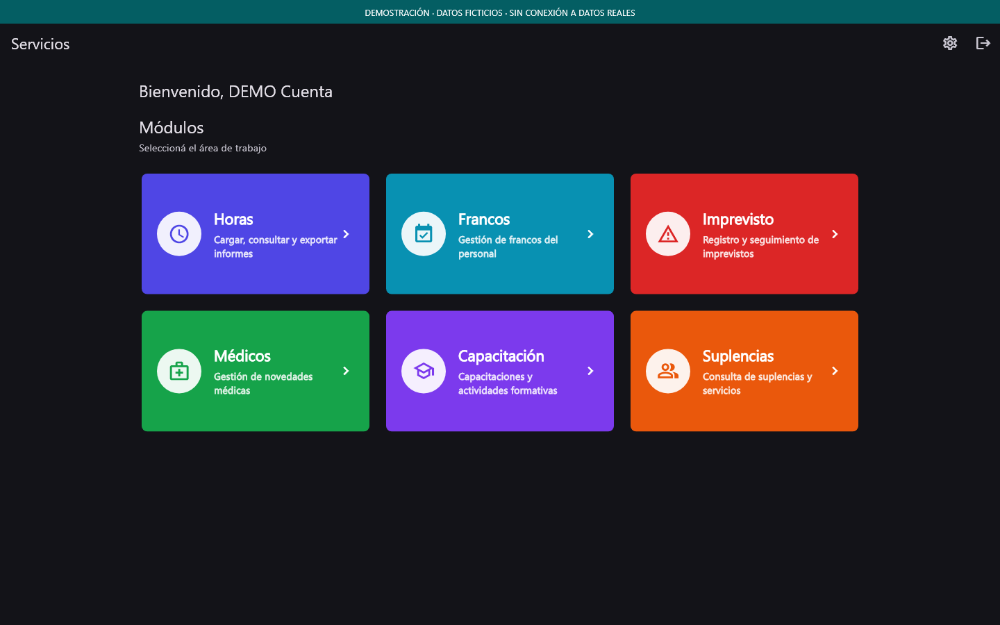

<div align="center">
  
  <h1>Gestión RRHH</h1>
  <p><strong>Gestión diaria de Recursos Humanos desde una aplicación de escritorio.</strong></p>
  <p>Flutter · Dart · Riverpod · Supabase · Windows</p>
  <a href="https://github.com/gabyboan/hesm-gestion-rrhh/actions/workflows/quality.yml">
    
  </a>
  <a href="https://github.com/gabyboan/hesm-gestion-rrhh/releases">
    
  </a>
</div>

## Qué hace

Gestión RRHH reúne las novedades del personal en siete módulos con acceso por
roles. Permite registrar movimientos, consultar información y preparar informes
y partes médicos desde Windows.

| Módulo | Funciones principales |
| --- | --- |
| **Horas** | Carga, consultas, cupos, excedentes e informes mensuales exportables. |
| **Francos** | Registro, consulta y administración de movimientos según permisos. |
| **Imprevistos** | Carga y seguimiento de novedades del personal. |
| **Médicos** | Partes con QR y código manual, familiares, domicilio histórico, devolución con historial, vista previa y bandeja de impresión. |
| **Suplencias** | Consulta y gestión de registros con permisos por usuario. |
| **Licencias** | Carga, modificación, anulación y exportación; catálogo operativo, cupos de Estudio y revisión separada de importaciones. |
| **Ficha** | Datos del personal, historial integrado desde 2026, resumen anual y planilla PDF con continuaciones. |

## Estado del trabajo · 11 de noviembre de 2026

El desarrollo actual incorpora **Ficha y Licencias**. Licencias concentra las
cargas y correcciones; Ficha consulta los mismos registros confirmados y los
imprevistos de su módulo de origen, sin duplicarlos. La planilla incluye vista
preliminar, ampliación, impresión y PDF con tantas hojas como requiera el historial.

Los últimos ajustes conservan la cantidad verificada en las fichas de papel,
admiten dos francos del código 60 en una sola fecha y muestran en gris la
documentación pendiente sin alterar los cómputos. Las importaciones que requieren
revisión permanecen separadas de las consultas y exportaciones habituales.

La última distribución operativa documentada es **1.0.6.7**, del 2 de noviembre.
Los cambios posteriores se incorporan al código con sus pruebas y migraciones;
su inclusión aquí no acredita una nueva instalación en los puestos de trabajo.
Ver el [estado actual y los pendientes](docs/ESTADO_ACTUAL.md) y el
[alcance de Ficha y Licencias](docs/FICHA_Y_LICENCIAS.md).

## Base operativa 1.0.6.7

- **Domicilio histórico:** cada parte conserva el domicilio guardado al emitirse,
  aunque después cambie la ficha. La vista previa y las reimpresiones usan esa
  copia. Los partes anteriores sin copia histórica lo indican explícitamente.
- **Una Gestión por cuenta:** el segundo ingreso se rechaza sin desconectar al
  primero. El servidor decide el acceso, lo renueva y permite recuperar la cuenta
  tras un cierre inesperado. Todos los clientes deben actualizarse para participar.
- **Impresión:** ajustes por impresora, pruebas repetibles y recuperación de la
  bandeja al cancelar o fallar un trabajo.
- **Inicio y cuenta:** verificaciones de conectividad y servicios, actualizaciones
  firmadas, MFA opcional, revalidación periódica y cierre por inactividad.

Detalles en el [registro de cambios](CHANGELOG.md). El repositorio publica código,
pruebas y una demo ficticia; los instaladores operativos se distribuyen por el
canal privado de actualizaciones.

## Recorrido visual



Las capturas se generan desde la interfaz con datos de demostración, sin consultar
la base de personal. Ver la [galería de módulos](docs/mockups/README.md).

## Probar la demo

Requisitos: **Flutter 3.38.6**, Dart **3.10.7** y un entorno de escritorio Windows
con las herramientas nativas de Flutter.

```powershell
flutter pub get --enforce-lockfile
flutter run -d windows -t tool/demo/main.dart
```

La demo permite recorrer los siete módulos y revisar PDF con datos ficticios. Bloquea
las escrituras y las solicitudes HTTP; no necesita una cuenta de Supabase.

## Ejecutar con un entorno propio

```powershell
Copy-Item credenciales.env.example credenciales.env
# Completar la URL y la clave publishable/anon del entorno de desarrollo.
flutter run -d windows
```

También se pueden pasar `SUPABASE_URL` y `SUPABASE_ANON_KEY` mediante
`--dart-define`. El archivo de configuración es externo al ejecutable.

El backend necesita las tablas, RPC y roles del proyecto. Las migraciones públicas
documentan su evolución y **no constituyen una instalación completa desde cero**.
Revisar el esquema y el historial de un entorno de prueba antes de aplicarlas.
Las cargas nominales, credenciales, respaldos y datos de personal quedan excluidos
del repositorio.

## Verificación

```powershell
flutter analyze --fatal-infos
flutter test --reporter expanded
```

Para los contratos SQL, con PostgreSQL 16 instalado en Windows:

```powershell
powershell -NoProfile -File tool/test_database.ps1
```

El runner crea un clúster temporal con datos ficticios y comprueba permisos,
migraciones, domicilio de emisión, dos ingresos concurrentes y los contratos de
Ficha y Licencias, incluido el cupo de Estudio ante cargas simultáneas. No lee las
credenciales del entorno operativo. GitHub Actions ejecuta análisis, pruebas
Flutter, contratos PostgreSQL y detección de secretos en cada pull request.

Los resultados de la revisión actual y las comprobaciones históricas de la
versión instalada están separados en [Validación](docs/VALIDACION.md).

## Estructura

```text
lib/
  app/              Tema y composición de la aplicación
  core/             Conectividad, inicio, exportación, UI y actualizaciones
  features/         auth, ficha, francos, horas, imprevistos, licencias,
                    medicos, preferences, shell y suplencias
supabase/
  migrations/       Evolución pública del esquema y los permisos
  tests/            Contratos con datos ficticios
test/               Pruebas de modelos, repositorios e interfaz
tool/               Demo, validación y empaquetado
```

Cada funcionalidad separa `application`, `data`, `domain` y `presentation`.
Ver las [convenciones de módulos](lib/features/README.md).

## Documentación

| Guía | Contenido |
| --- | --- |
| [Cambios y versiones](CHANGELOG.md) | Evolución funcional y versión actual. |
| [Estado actual](docs/ESTADO_ACTUAL.md) | Trabajo implementado, distribución documentada y pendientes. |
| [Ficha y Licencias](docs/FICHA_Y_LICENCIAS.md) | Historial compartido, planilla, códigos y revisión de evidencia. |
| [Licencias](docs/LICENCIAS.md) | Cargas, cupos, permisos, exportación e importaciones. |
| [Demo y desarrollo Windows](docs/WINDOWS.md) | Ejecución, demo y validación manual. |
| [Instalación y actualizaciones](docs/INSTALADOR_Y_ACTUALIZACIONES.md) | Instaladores, firmas y distribución privada. |
| [Inicio y diagnóstico](docs/INICIO_DIAGNOSTICO.md) | Comprobaciones de servicios y recuperación. |
| [Partes médicos y QR](docs/PARTES_MEDICOS_QR.md) | Emisión, devolución e historial. |
| [Impresión médica](docs/IMPRESION_MEDICA.md) | Calibración por impresora y pruebas. |
| [Sesión única](docs/SESION_UNICA_GESTION.md) | Reserva por cuenta, concurrencia y recuperación. |
| [MFA opcional](docs/MFA_Y_SEGURIDAD_AUTH.md) | Alta, verificación y desactivación. |
| [Duración y revalidación](docs/LIMITES_SESIONES.md) | Límites de acceso y autenticadora. |
| [Validación](docs/VALIDACION.md) | Evidencia automatizada e histórica. |
| [Respaldos](docs/RESPALDOS_BASE_DATOS.md) | Copias cifradas, ensayo aislado de restauración y tarea de Windows. |
| [Revisión de privacidad](docs/REVISION_PRIVACIDAD.md) | Limpieza y cierre de la revisión histórica. |
| [Contribuir](CONTRIBUTING.md) | Preparación de cambios y comprobaciones. |

La revisión de privacidad histórica está cerrada según la confirmación del
responsable del 22 de octubre de 2026, conservada en su documentación.
