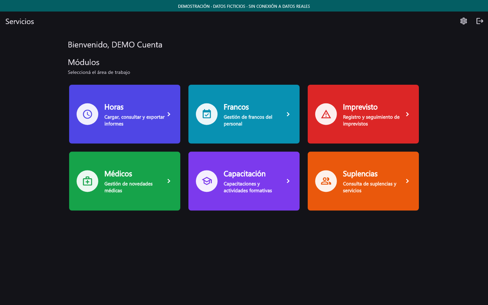

<div align="center">
  
  <h1>Gestión RRHH</h1>
  <p><strong>Una herramienta de escritorio para ordenar la gestión diaria de Recursos Humanos.</strong></p>
  <p>Flutter · Dart · Supabase · Windows</p>
</div>

<p align="center">
  <a href="https://github.com/gabyboan/hesm-gestion-rrhh/actions/workflows/quality.yml">
    
  </a>
</p>

---

## El proyecto

**Gestión RRHH** reúne en una aplicación de escritorio herramientas para
registrar, consultar y dar seguimiento a novedades del personal. El objetivo es
reducir tareas manuales y ofrecer información clara para el trabajo cotidiano
del área.

Es un proyecto en desarrollo activo, construido con Flutter y Supabase. Esta
presentación describe sus capacidades sin exponer datos ni credenciales de
personas.
El símbolo del README también se usa como icono de la aplicación de Windows y
emplea el color institucional `#045e63`.

## Módulos

| Área | Qué permite hacer |
| --- | --- |
| **Horas** | Cargar y consultar horas por persona; revisar cupos, excedentes e informes mensuales. |
| **Francos** | Registrar y consultar francos del personal. |
| **Imprevistos** | Registrar novedades y hacer su seguimiento. |
| **Médicos** | Emitir partes, completar datos del domicilio y familiares, y previsualizar y ajustar la impresión. |
| **Suplencias** | Consultar y gestionar registros según los permisos asignados. |

El acceso a cada área depende de los roles configurados en Supabase. También
incluye preferencias de tema, control de sesión por inactividad y búsquedas por
múltiples términos.

Médicos incluye edad familiar en meses para menores de un año y una bandeja
para revisar e imprimir varios partes en un único trabajo. Una cancelación
conserva los partes pendientes en la sesión.

## Vista del sistema

### Panel de módulos



Las capturas se generan desde la interfaz real, con datos ficticios y sin
conectarse a la base de personal. Podés recorrer los cinco módulos en la
[galería completa](docs/mockups/README.md).

## Tecnologías y estructura

- **Flutter y Dart** para la aplicación de escritorio.
- **Riverpod** para el estado y la coordinación entre capas.
- **Supabase** para autenticación, datos y permisos.
- **Arquitectura por funcionalidades:** `application`, `data`, `domain` y
  `presentation`.
- **Windows** como plataforma de escritorio.

## Desarrollo local

Para probar la aplicación normal o una demo de consulta sin conexión, consultá
la [entrega de Windows](docs/WINDOWS.md). Incluye instrucciones de compilación,
empaquetado y un recorrido de validación manual con datos ficticios.

### Requisitos

- Flutter 3.38.6 y Dart 3.10.7, las versiones verificadas en esta entrega.
- Acceso a un proyecto de Supabase de desarrollo con el esquema y los permisos
  requeridos.

### Ejecutar

Instalá las dependencias:

```powershell
flutter pub get
```

Para desarrollo local, copiá la plantilla y completá las credenciales de tu
entorno de prueba:

```powershell
Copy-Item credenciales.env.example credenciales.env
```

Como alternativa, podés pasarlas mediante `--dart-define`:

```powershell
flutter run `
  --dart-define=SUPABASE_URL=https://your-project-ref.supabase.co `
  --dart-define=SUPABASE_ANON_KEY=your-supabase-anon-key
```

No guardes credenciales reales, claves `service_role`, datos de personal ni
exportaciones en el repositorio. Las migraciones deben revisarse y validarse en
una base de prueba antes de aplicarlas a cualquier entorno compartido.

### Verificar

```powershell
flutter analyze
flutter test
```

El workflow de GitHub Actions ejecuta estas comprobaciones con Flutter 3.38.6
al actualizar `main` y en cada pull request.

## Alcance y estado

- Aplicación de escritorio en desarrollo activo; no es un servicio público ni
  una demo conectada para visitantes.
- Los PR [#2](https://github.com/gabyboan/hesm-gestion-rrhh/pull/2) y
  [#3](https://github.com/gabyboan/hesm-gestion-rrhh/pull/3) están integrados en
  `main`, con análisis estático y 83 pruebas aprobados también en CI.
- Las pruebas manuales de sesión, permisos e impresora fueron aprobadas,
  según confirmación del responsable del proyecto del 21 de octubre de 2026.
- Un despliegue de migraciones requiere revisar el esquema y el historial
  aplicado del entorno de destino.
- Las capturas y ejemplos destinados al portfolio deben usar exclusivamente
  información ficticia.

## Documentación de la entrega

| Documento | Contenido |
| --- | --- |
| [Registro de cambios](CHANGELOG.md) | Mejoras y comportamiento por módulo. |
| [Entrega GitHub](docs/ENTREGA_GITHUB.md) | Commits realizados, inventario de publicación y migraciones recuperadas. |
| [Windows](docs/WINDOWS.md) | Aplicación normal, demo de consulta y validación manual. |
| [Cambios por archivo](docs/CAMBIOS_POR_ARCHIVO.md) | Inventario individual, dependencias y propuesta de commits. |
| [Validación](docs/VALIDACION.md) | Pruebas Flutter, contratos SQL y límites de despliegue. |
| [Preparación para GitHub](docs/PREPARACION_GITHUB.md) | Privacidad y estado de publicación. |
| [Revisión de privacidad](docs/REVISION_PRIVACIDAD.md) | Historial público, capturas, escaneos y propuesta de limpieza. |

---

<div align="center">
  <sub>Proyecto de portfolio · Aplicación de escritorio para gestión de RRHH</sub>
</div>
