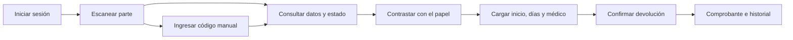

# Partes médicos: QR y control de devolución

Migración aplicada el 23/10/2026 en el proyecto de destino, después de
acortar el código manual a ocho números.
La app móvil todavía no está implementada. Falta recompilar y distribuir el escritorio.

El 23/10/2026 también se aplicó `20261023102714_partes_medicos_por_fecha.sql`
para el selector de fecha. Se verificó la consulta diaria bajo el rol
`authenticated`, el filtro por fecha y búsqueda y el rechazo sin sesión. Los
asesores no reportaron avisos nuevos. La suite Flutter pasó con 94 pruebas;
el caso SQL local comprobó más de 500 partes en un día y excluyó los anulados.

## Uso en el escritorio

«Partes registrados» abre con la fecha de hoy en Buenos Aires. El selector
permite elegir un día desde el calendario, avanzar o retroceder y volver a
«Hoy». El buscador se combina con esa fecha; al cambiar de día también cambia
la vista preliminar. La opción «Hoy» sigue la fecha si la pantalla queda
abierta a medianoche. Al emitir un parte se selecciona su fecha de emisión.
El listado diario consulta la base antes de filtrar resultados y no depende
del límite de 500 filas del listado general. La demo conserva su fecha ficticia.

El QR ocupa el espacio libre a la izquierda de «Corto tratamiento», en la ubicación
indicada en la captura. Se imprime en negro, con margen blanco, corrección de
errores alta y un código manual debajo, por ejemplo `PM-0000-0422`.
La vista preliminar de una persona sin parte registrado todavía no lleva QR.
En ese borrador se señala el espacio «QR al registrar». En un parte emitido,
la cabecera de la vista preliminar muestra además un QR que se puede pulsar
para ampliarlo y escanearlo sin recorrer toda la hoja. La demo usa códigos
ficticios para que también se pueda revisar esa ubicación.

El botón «Listado de Enfermería» consulta la carrera registrada en la ficha y
prepara automáticamente los partes de Enfermería para la fecha elegida,
independientemente de la búsqueda visible. El diálogo permite copiar un
listado con persona, DNI/legajo, modalidad AD/AC/PC, ART, familiar,
aclaraciones y código de parte. La clasificación requiere aplicar
`20261023111125_medicos_carrera_enfermeria.sql` en Supabase. El correo se pega
y se envía desde el cliente de correo que utilice el operador; la app no registra
un envío ni asigna un destino permanente.

Al emitir, el servidor asigna un código numérico único de ocho dígitos, con
verificador Luhn para detectar errores de tipeo. Se recupera junto a
los datos definitivos del parte antes de imprimir. Reimprimir y completar el
domicilio conserva ese código. Los partes existentes reciben código al aplicar
la migración; los papeles que ya circulan necesitan reimpresión para llevarlo.

«Control por código» permite pegar el contenido de un QR o escribir el código
manual. También se puede abrir «Controlar devolución» junto al parte registrado.
Se consultan persona, DNI, fecha, modalidad, familiar y estado de anulación;
se ingresan inicio, días corridos, médico y matrícula tal como figuran en el papel.
El operador confirma que contrastó esos datos antes de guardar.

Cada registro conserva usuario autenticado, hora del servidor, días, fechas,
médico y matrícula. Cero días representa un papel sin días aprobados y no genera
fecha final. Para tres días desde el 23/10/2026, el último día es el 25/10/2026.
El límite técnico es 3650 días; no representa un cupo ni una regla de licencia.

La primera devolución requiere `MEDICOS_LECTURA` y `MEDICOS_CONTROL`.
Rectificar requiere además `MEDICOS_ADM` y un motivo. Se agrega una versión;
el historial anterior permanece. Los clientes no pueden editar ni borrar la
tabla de controles. Un parte anulado conserva su consulta e historial y rechaza
nuevos controles. El bloqueo de la fila y la versión esperada impiden que dos
operadores guarden la misma devolución desde una consulta desactualizada.

## Alcance de la auditoría

El QR contiene `HESM:PM:1:00000422`: identifica el registro de origen.
Todos los datos se recuperan del servidor con sesión y permisos, incluidos los
días registrados después de devolver el papel. No se incluyen diagnósticos,
domicilios ni DNI dentro del código.

El código no es una contraseña ni una firma del médico. Puede ser copiado y
no demuestra por sí solo que una firma, sello o prescripción en papel sea
auténtica. El control implementado deja constancia de qué usuario transcribió
los datos y sus correcciones. El nombre y la matrícula del médico son por ahora
una transcripción: falta el padrón de médicos habilitados y su validación.
El domicilio impreso sigue usando la ficha vigente, como antes; esta entrega
no agrega un archivo inmutable de cada PDF emitido.

## Diseño de la futura app móvil



1. **Inicio:** «Escanear parte» como acción principal, «Ingresar código» e
   «Historial» como alternativas. El lector pide acceso a la cámara al abrirse.
2. **Lector:** recuadro para enfocar, linterna y entrada manual. Lee una sola vez
   por captura; mantiene el código hasta que termine la consulta. No abre enlaces
   arbitrarios encontrados por la cámara.
3. **Parte encontrado:** persona, DNI/legajo, tipo, fecha, familiar si corresponde,
   código y estado. Un anulado muestra el aviso y bloquea la devolución. Un parte
   ya controlado muestra sus días e historial antes de ofrecer una rectificación
   a quien tenga permiso.
4. **Devolución:** inicio, días corridos, fecha final calculada, médico y matrícula;
   confirmación de lectura del papel. Con el padrón implementado, el médico se
   seleccionará de un catálogo con matrícula y habilitación comprobadas.
5. **Comprobante:** días, período, usuario, fecha/hora y versión. Una pérdida de
   conexión conduce a volver a consultar antes de reintentar; el teléfono solo
   informa éxito después de recibir la confirmación del servidor.

El primer lector será interno a la app. El contenido actual es un identificador
de texto; no abre una web con la cámara común del teléfono. Para eso habrá que
definir y desplegar un dominio con enlaces de aplicación, manteniendo el acceso
autenticado a los datos. No se inventa una URL pública que todavía no existe.

Para licencias de otras clases se debe definir un catálogo de tipos y reglas
antes de extender este contrato; hoy el registro se refiere al parte médico.
La foto del papel devuelto, su conservación y la aprobación profesional del
médico quedan para una etapa con requisitos y permisos definidos.

## Contrato para la app

Reutilizar `ParteMedicoQr.parse` para aceptar QR, texto sin guiones o código
manual, normalizar los números conservando ceros iniciales, verificar el dígito
de control y rechazar versiones desconocidas. En Android se usa teclado numérico;
no hace falta ingresar «PM» ni los guiones. Si se superan 9.999.999 partes, el
código crece para conservar la unicidad, sin truncar los números.

| RPC | Entrada | Resultado |
| --- | --- | --- |
| `rpc_medicos_documento` | `p_codigo` normalizado **o** `p_id` | `parte` e historial `controles`, incluso anulados |
| `rpc_medicos_registros` | búsqueda opcional | Listado vigente con `codigo_qr` |
| `rpc_medicos_registros_dia` | `p_fecha` y búsqueda opcional | Partes vigentes de ese día, en orden de emisión |
| `rpc_medicos_carreras` | `p_dnis` | Carrera actual usada para identificar Enfermería |
| `can_medicos_control` | Ninguna | Permiso de control de devolución |
| `rpc_medicos_control_guardar` | Código, inicio, días, médico, matrícula, versión esperada y motivo cuando se rectifica | Nueva versión con autor y hora del servidor |

No enviar `usuario_registro`, `registrado_at` ni una fecha final desde el cliente.
El servidor los establece. La versión esperada inicial es 0; después se envía
la última versión consultada. Ninguna escritura se reintenta automáticamente.
La app usa la misma base y autenticación que el escritorio, sin claves de servicio.

## Activación

La migración `20261023093056_partes_medicos_qr_control.sql` figura aplicada en
el historial remoto. Se verificaron 48 partes, 48 códigos distintos, cero códigos
inválidos y cero controles de devolución creados durante el despliegue. Una
consulta bajo el rol `authenticated` confirmó el listado y la recuperación del
mismo parte por ID y por código, dentro de una transacción de solo lectura.
La tabla de controles tiene RLS y carece de permisos de escritura directa para
clientes. El esquema `private` no está expuesto en la API.

Se ejecutaron los asesores de seguridad antes y después. El nuevo aviso INFO
de [RLS sin políticas](https://supabase.com/docs/guides/database/database-linter?lint=0008_rls_enabled_no_policy)
corresponde a la tabla interna de controles, cuyo acceso está revocado a clientes
y se realiza mediante RPC con validación de permisos. No se habilita acceso
directo para eliminar ese aviso. Los demás hallazgos pertenecen al esquema previo.

Para el uso operativo quedan la asignación de `MEDICOS_CONTROL` a quienes
corresponda y la distribución del ejecutable actualizado. No se asignó ese rol
a ninguna persona durante esta migración.

Procedimiento de referencia para otros entornos:

1. Revisar el historial de migraciones del destino, incluyendo edad en meses y
   buscadores. La migración nueva es
   `20261023093056_partes_medicos_qr_control.sql` y no cambia la firma de creación.
2. Validar y aplicar primero en un entorno de prueba con el esquema real.
   El esquema `private` debe permanecer fuera de los esquemas expuestos por la API.
   Las funciones públicas usan `SECURITY INVOKER`; los helpers privados comprueban
   sesión y permisos. Referencia: [funciones de Supabase](https://supabase.com/docs/guides/database/functions).
3. Asignar `MEDICOS_CONTROL` a los operadores habilitados mediante la gestión
   habitual de roles. La migración crea el rol sin asignarlo a ninguna persona.
4. Distribuir el escritorio después de aplicar la migración. Probar una hoja real
   en A4, al 100 %, y ajustar la impresora con el diálogo existente si hace falta.
5. Ejecutar los asesores de Supabase sobre ese entorno antes de producción.

## Verificación local

Se comprobaron las pruebas Flutter del módulo, generación de PDF y lectura con
ZXing en 150/300 dpi y giro de 90 grados, tanto sobre el escaneo como en el PDF
para la hoja preimpresa. La muestra usa exclusivamente datos ficticios.

```powershell
flutter test --no-pub test/features/medicos
flutter test --no-pub tool/generate_parte_qr_preview_test.dart
python tool/testing/verify_parte_qr.py
```

El verificador de lectura requiere PyMuPDF, Pillow y zxing-cpp. Los artefactos
se generan en `build/qr-preview/`, fuera del control de versiones.

La migración y sus consultas se ejecutaron en PostgreSQL 16 local, sobre una
base desechable con `tool/testing/medicos_qr_fixture.sql`, las tres funciones
de búsqueda de la migración de buscadores y
`tool/testing/medicos_qr_assertions.sql`. Se verificaron recuperación por ID/código,
búsqueda manual, historial, cálculo inclusivo, cero días, versión desactualizada,
motivo obligatorio, permisos de lectura/control/administración y anulación.
Ese fixture reproduce las dependencias del cambio; no sustituye una prueba
de integración con el esquema completo ni el control de roles del entorno real.
