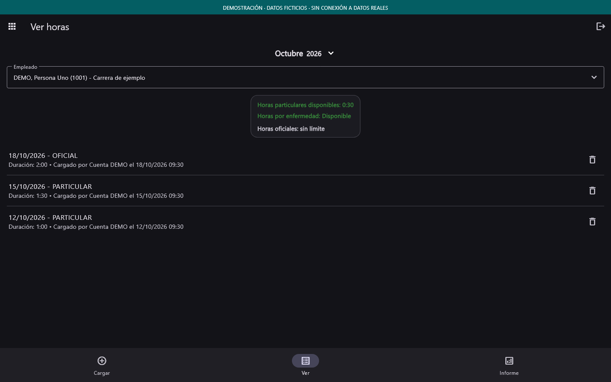
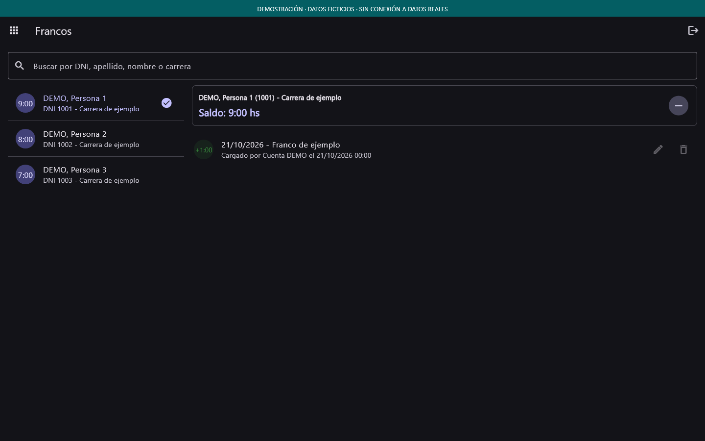
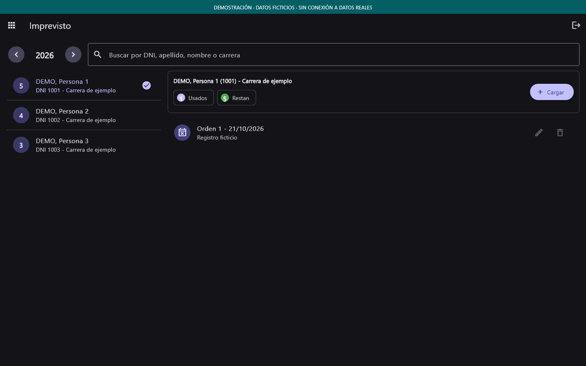
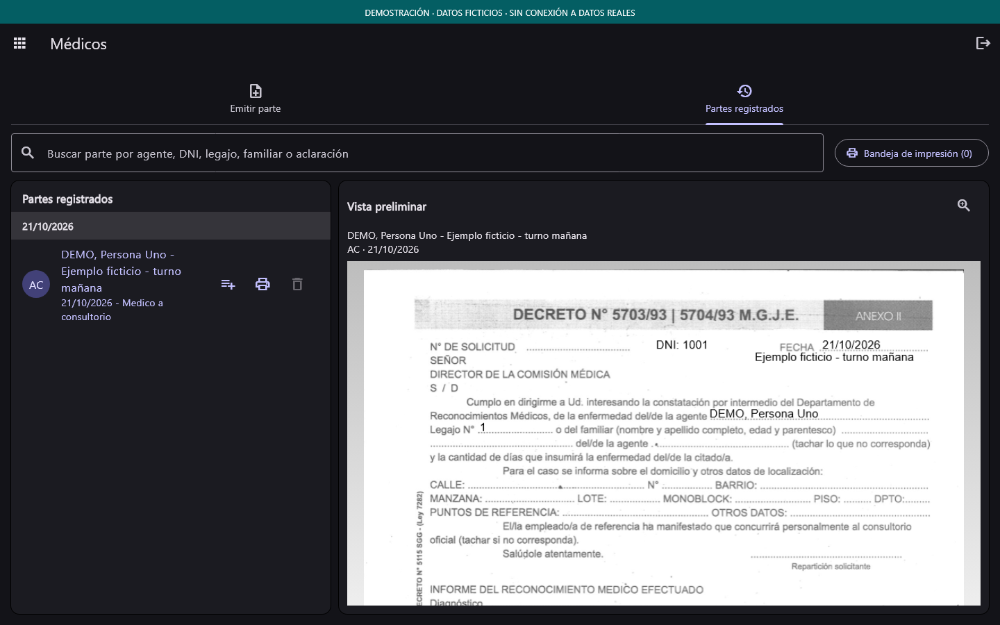
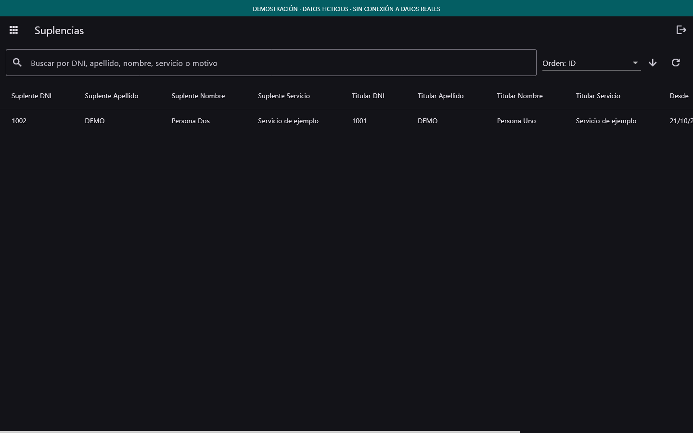

# Galería de demostración

Capturas de los widgets reales de Flutter a **1440 × 900**, con tema oscuro.
Todas las personas, registros y documentos son ficticios. Los identificadores
`1001`–`1003` son ejemplos cortos; no corresponden a personal del sistema.
Cada imagen lleva un aviso visible de demostración.

| Panel | Horas |
| --- | --- |
|  |  |
| Francos | Imprevistos |
|  |  |
| Médicos | Suplencias |
|  |  |

## Cómo reproducirlas

En Windows, con Flutter 3.38.6 y PowerShell:

```powershell
flutter pub get --enforce-lockfile
powershell -NoProfile -File tool/generate_demo_gallery.ps1
```

El generador reemplaza los proveedores por fixtures en memoria y bloquea el
proveedor de Supabase. No inicializa una sesión ni consulta servicios remotos.
La vista médica usa el PDF generado por la aplicación para el mismo parte
ficticio; Windows lo rasteriza para que Flutter pueda mostrarlo en la captura.
No imprime ni guarda registros en una base.

El recurso del formulario médico está vacío antes de completarlo con los
fixtures. Los archivos intermedios se escriben en `build/demo-gallery/`,
ignorado por Git. La fuente Segoe UI se carga desde Windows; no se redistribuye
su archivo. La galería se genera mediante una herramienta separada y no añade
pruebas a la suite funcional de `test/`.

Las capturas anteriores de Francos e Imprevistos con datos identificables
permanecen fuera de la entrega. El tratamiento de referencias antiguas de
GitHub se explica en la [revisión de privacidad](../REVISION_PRIVACIDAD.md).
